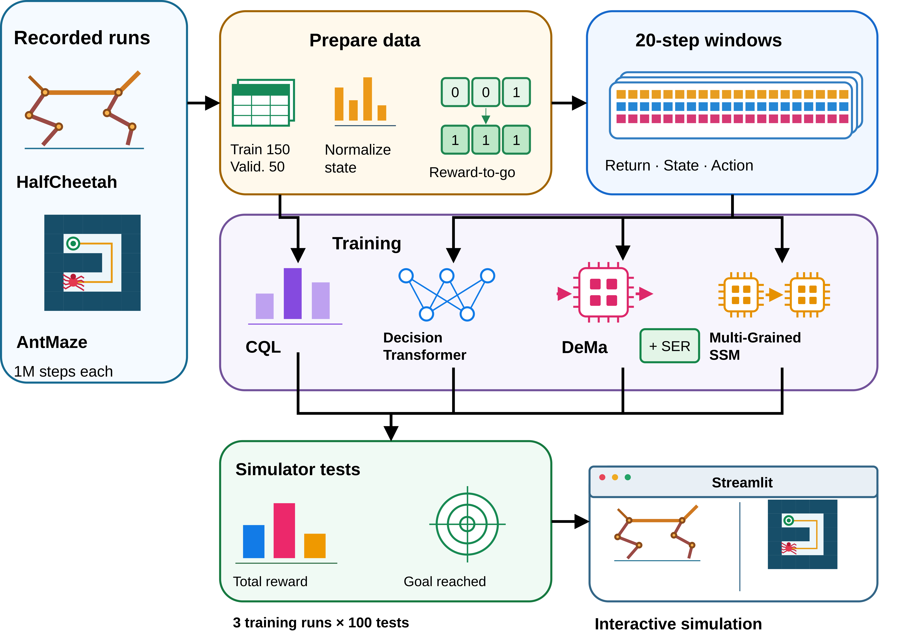

# DeMa: Linear-Time Sequence Modeling for Offline Reinforcement Learning

[](https://www.python.org/)
[](https://pytorch.org/)
[](https://dema-test.streamlit.app)

**[Live demo](https://dema-test.streamlit.app)**

This project studies **Decision Mamba (DeMa)** for learning robot control from recorded experience. It compares DeMa with **Decision Transformer (DT)** and other offline reinforcement learning methods on HalfCheetah and AntMaze, with experiments on control performance, computation, and model design.

A Streamlit interface brings the experiments into view: watch the robots move, compare models, and follow their actions and rewards during a run.

## Project overview

In reinforcement learning, an agent observes its surroundings, takes an action, and receives a reward or penalty. Its goal is to earn a higher total reward over a complete run. **Offline reinforcement learning** uses previously recorded runs for training, then tests the trained model in a simulator.

Decision Transformer uses attention to compare information from earlier steps. As the history grows, this comparison requires more computation. DeMa uses Mamba's selective memory mechanism to process the sequence, carrying useful information forward. This project investigates how that different approach affects robot control and computational cost.

## Tasks and datasets

| Task | What the agent learns | How it earns reward |
|---|---|---|
| **HalfCheetah** | Move a two-legged simulated robot forward | Forward speed, reduced by the effort used to move its joints |
| **AntMaze** | Guide a four-legged robot around walls to a goal | +1 for each step near the goal; 0 elsewhere |

The training data is accessed through **Minari**, using the HalfCheetah medium dataset and the D4RL AntMaze U-Maze dataset. Each recorded step includes the robot's measurements, the action taken, the reward received, and the measurements after that action.

| Dataset property | HalfCheetah | AntMaze |
|---|---:|---:|
| Complete recorded runs | 1,000 | 1,430 |
| Recorded steps | 1,000,000 | 1,000,000 |
| Maximum steps per run | 1,000 | 700 |
| Input measurements per step | 17 | 31 |
| Joint controls per action | 6 | 8 |

## Models

| Method | Approach |
|---|---|
| **DeMa** | The main model, using selective memory to process the history and predict the next action |
| **Decision Transformer** | Uses attention over the history to predict the next action |
| **Conservative Q-Learning (CQL)** | Learns how useful each action is and lowers estimates for unfamiliar actions. Tested on HalfCheetah. |
| **Multi-Grained State Space Model** | Processes information within each recorded step and across the sequence of steps |
| **DeMa with Self-Evolution Regularization (SER)** | A training variant that combines recorded actions with the model's own predictions as learning targets |

## How it works

1. **Prepare recorded experience.** Load the dataset, select training runs, and normalize the robot's measurements.
2. **Build short histories.** Prepare sequences of measurements, previous actions, and the requested remaining reward.
3. **Train action prediction.** Teach the model to predict the actions recorded in those sequences.
4. **Test in the simulator.** Let the trained model choose actions and measure the rewards it earns.
5. **Compare and inspect.** Analyze performance and design changes in the notebooks, then replay agent behavior in Streamlit.

The requested reward guides action prediction. The reward actually earned comes from the simulator.



## Experiments and notebooks

The experiments compare rewards, variation between independently trained models, model size, and computational performance. Ablation studies change a design choice to examine its effect, including input layout, normalization, timestep information, and history handling.

The main reward comparisons use **three independently trained seeds**, with **100 evaluation runs per seed and requested reward target**. The analysis reports average reward, variation between training runs, and median reward.

At the HalfCheetah target of **12,000**, DeMa earns **22% higher average reward** than baseline DT. AntMaze goal arrival matches DT at **81%** for target 538. Adding SER raises DeMa's arrival rate to **86.7%**. Model size, timing, and other results appear alongside these comparisons.

| Notebook | Contents |
|---|---|
| [Main comparison](01_DeMa_vs_DecisionTransformer_vs_CQL.ipynb) | DeMa, DT, and CQL; training curves, rewards, model size, and computation |
| [Model variants](02_SER_and_MultiGrainedSSM_vs_DeMa.ipynb) | SER and Multi-Grained SSM compared with their corresponding baselines |
| [Ablation studies](03_Ablation_Studies.ipynb) | Input layout, normalization, step embeddings, learning curves, and recurrent memory |

The notebooks contain executed tables and plots that can be viewed directly on GitHub. Generated plots use `figures/`. Optional W&B cells load experiment histories. The [training guide](training/README.md) explains the training files and commands.

## Interactive demo

Choose a task, select the models, and press **Run**. The app performs simulation with trained checkpoints and replays the resulting run.

The interface offers **DeMa, DT and Random Actions** on both tasks. DeMa and DT use included pretrained weights. Random Actions samples joint controls without training.

- Compare DeMa with DT or Random Actions, show all three, or view DeMa alone.
- Follow actions, robot measurements, step rewards, total rewards, and the AntMaze route during playback.
- Hover over the growing reward plot for values and see the run's winner after playback finishes.
- Pause, step through the replay, or download the run data as CSV.

Compared agents use the same initial conditions. AntMaze samples new start and goal positions within the original training areas. The U-maze layout stays fixed.

## Repository structure

```text
.
├── app.py
├── run.py
├── train_compare.py
├── 01_DeMa_vs_DecisionTransformer_vs_CQL.ipynb
├── 02_SER_and_MultiGrainedSSM_vs_DeMa.ipynb
├── 03_Ablation_Studies.ipynb
├── assets/
│   ├── models/
│   │   ├── dema.pth
│   │   ├── decision_transformer.pth
│   │   ├── multi-grained_ssm.pth
│   │   └── antmaze/
│   │       ├── dema.pth
│   │       ├── decision_transformer.pth
│   │       ├── multi-grained_ssm.pth
│   │       └── dema_ser.pth
│   ├── simulation.html
│   ├── simulation.css
│   ├── simulation.js
│   └── half_cheetah_large_floor.xml
├── training/
│   ├── train_cql.py
│   ├── cql.py
│   ├── requirements.txt
│   └── README.md
├── .streamlit/
│   └── config.toml
├── .env.example
├── .gitignore
├── packages.txt
├── requirements.txt
└── README.md
```

`app.py` runs the interface, `train_compare.py` defines and trains the sequence models, and `training/` contains the CQL implementation. The files in `assets/` provide the demo weights, simulation display, and robot environment.

## Local setup

Use **Python 3.13** and open a terminal in the repository root. The trained demo checkpoints are included.

### Windows

```powershell
py -3.13 -m venv venv
.\venv\Scripts\python.exe -m pip install -r requirements.txt
.\venv\Scripts\python.exe run.py
```

### macOS

```bash
python3.13 -m venv venv
./venv/bin/python -m pip install -r requirements.txt
./venv/bin/python -m streamlit run app.py
```

### Linux (Ubuntu / Debian)

```bash
sudo apt-get update
sudo apt-get install -y libosmesa6 libgl1
python3.13 -m venv venv
./venv/bin/python -m pip install -r requirements.txt
./venv/bin/python -m streamlit run app.py
```

Open `http://localhost:8501`. For later launches, repeat your platform's launch command. Stop the server with `Ctrl+C`. The interface uses CPU inference, so a GPU is not required for playback.

To open the notebooks locally:

```powershell
.\venv\Scripts\python.exe -m jupyter notebook
```

On macOS and Linux, use `./venv/bin/python -m jupyter notebook`.

### Streamlit deployment

Upload the repository contents, including `assets/models/`. Use `app.py` as the entry point and Python 3.13. Keep `requirements.txt`, `packages.txt`, and `.streamlit/config.toml` at the repository root. `requirements.txt` installs Python dependencies; `packages.txt` supplies the Linux rendering libraries. The app reads the included weights directly, without an external model download.

## Training environment

Experiments ran on **Kaggle with GPU T4 x2**, providing two NVIDIA Tesla T4 GPUs with **16 GB memory each**. Independent runs could use separate GPUs.

| Setting | Value |
|---|---|
| Framework | PyTorch with CUDA |
| Local development OS | Windows |
| Training platform / OS | Kaggle / Linux |
| Data access | Minari |
| Simulation | MuJoCo, Gymnasium, and Gymnasium-Robotics |
| Experiment tracking | W&B |
| History length | 20 consecutive steps per sequence |
| Hidden width / layers | 128 / 3 |
| Batch size | 64 sequences per update |
| Training updates | 100,000 weight adjustments |
| Warm-up updates | 10,000 |

Model-specific learning rates, dropout settings, ablation options, and CQL setup are in the [training instructions](training/README.md). CQL retraining uses its separate requirements file.

## Acknowledgements

We acknowledge [Minari](https://minari.farama.org/) and its dataset contributors, the [HalfCheetah dataset provider](https://minari.farama.org/datasets/mujoco/halfcheetah/medium-v0/), and the [D4RL authors and maintainers](https://github.com/Farama-Foundation/D4RL) for the datasets and benchmark tasks used in this project.
